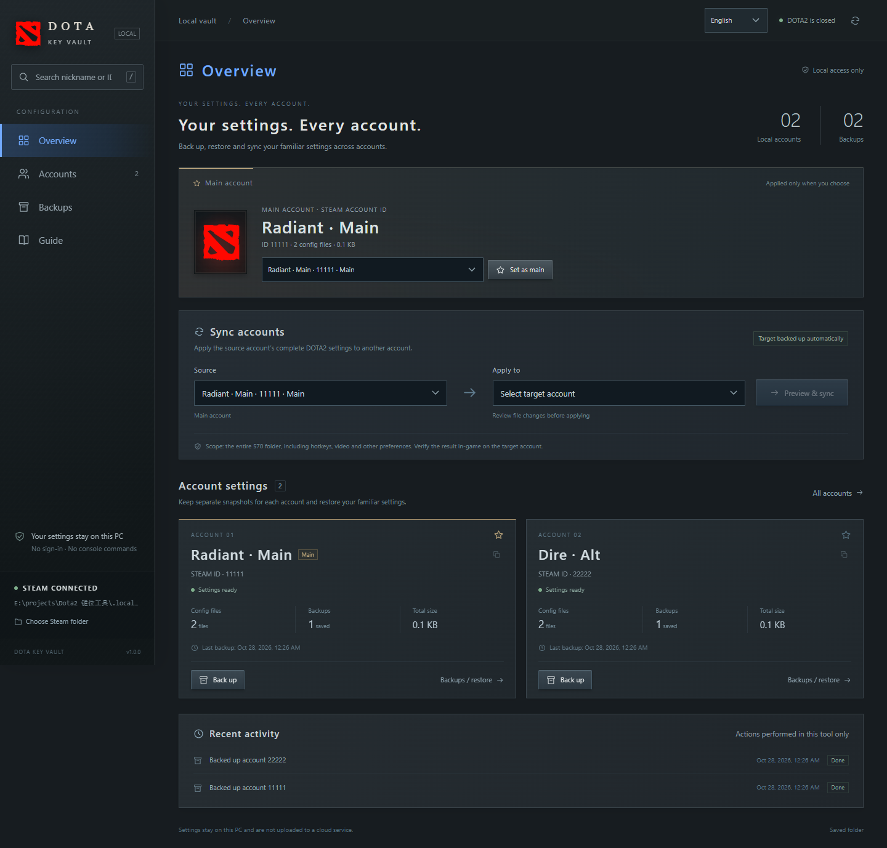
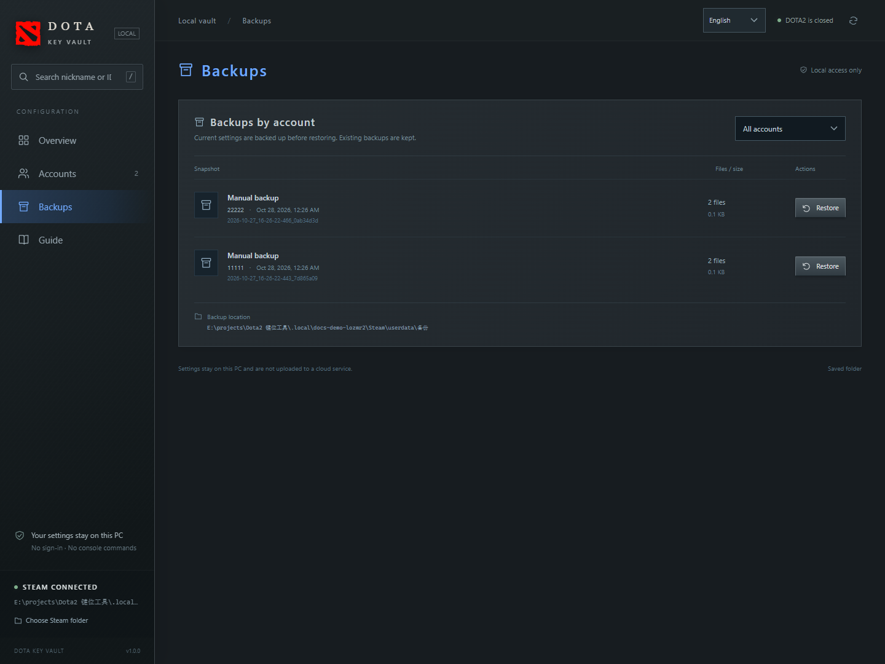
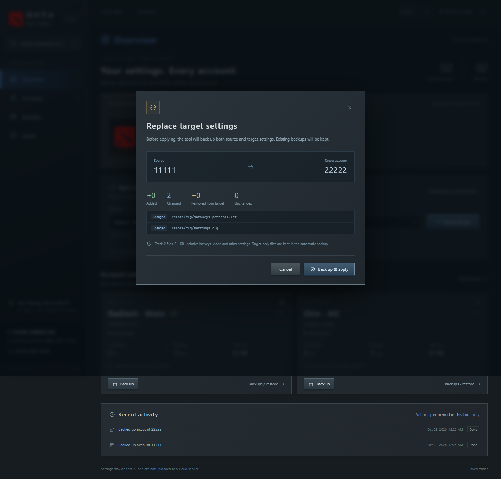
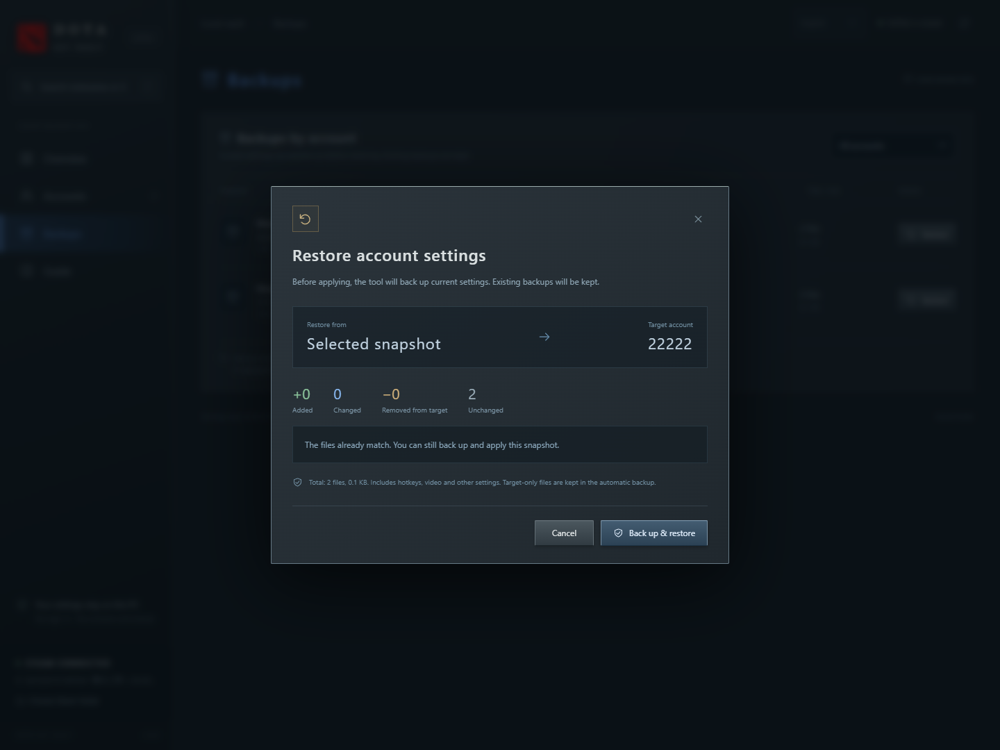

# DOTA Key Vault

[简体中文](README.md) | **English**

A local Windows tool for managing DOTA2 settings across Steam accounts. Back up your familiar setup, restore a snapshot, or apply your main account’s settings to another account.

**The portable release includes Node.js. Extract it and launch—no separate Node.js installation, npm install, database, or additional sign-in is needed.**

**For end users:** download the Windows x64 portable ZIP from this repository’s **Releases**, extract it, and run `启动工具.cmd`. **Code → Download ZIP** downloads source code without the Node.js executable; see [Development and packaging](#development-and-packaging) for source setup.

> This tool manages the **entire `userdata/<account ID>/570` folder**, including hotkeys, per-hero settings, casting preferences, video settings, other preferences, and Steam Cloud cache metadata. It does not copy hotkeys alone. Exit DOTA2 and wait for Steam Cloud to finish syncing before changing files.



Screenshots show the actual application with isolated demo accounts `11111` and `22222`. They do not contain personal account backups.

## Contents

- [Quick start](#quick-start)
- [Switch the interface language](#switch-the-interface-language)
- [Choose the Steam folder](#choose-the-steam-folder)
- [Choose a main account](#choose-a-main-account)
- [Back up settings](#back-up-settings)
- [Sync settings to another account](#sync-settings-to-another-account)
- [Restore or undo an operation](#restore-or-undo-an-operation)
- [Storage and file scope](#storage-and-file-scope)
- [Troubleshooting](#troubleshooting)
- [Share and update](#share-and-update)
- [Development and packaging](#development-and-packaging)

## Quick start

### Requirements

| Requirement | Details |
| --- | --- |
| Windows x64 | The portable release bundles Node.js 24.12.0 for Windows x64. |
| Browser | Chrome or Edge recommended. |
| Steam and DOTA2 | Local Steam installation and account settings are required. |
| Initialized accounts | Sign in to each account on this PC, launch DOTA2 at least once, and exit normally. |
| Folder permissions | The tool folder must be writable; your Windows user needs read/write access to Steam userdata. |

Normal use is offline and requires no Steam API key. The folder picker uses Windows PowerShell and Windows Forms, included with Windows.

### Launch

1. **Extract the entire ZIP** to a writable folder. Do not run it from inside the archive.
2. Double-click **`启动工具.cmd`** (the launcher).
3. Wait for your browser to open. Keep the launcher window running.
4. Check **STEAM CONNECTED** at the bottom left and verify the account list.
5. Exit DOTA2 and wait for Steam Cloud to finish syncing before backing up or applying settings.

The default address is `http://127.0.0.1:5700`. If an older version or another program occupies that port, the launcher tries subsequent ports. **Use the address opened by the launcher or printed in its window.**

The launcher reuses a service only when its installation path and code match the current copy. To stop the tool, press `Ctrl+C` in the launcher or close that window. Opening `public/index.html` directly does not work.

## Switch the interface language

Use the **简体中文 / English** selector at the top right. It changes navigation, buttons, dialogs, dates, standard backup labels, and operation messages without changing your settings.

On first use, the UI follows your browser language: Chinese browsers use Simplified Chinese; other languages use English. Your explicit choice is stored in this browser for this local address. Clearing browser storage or opening a different port may reset that preference.

Account nicknames, paths, account IDs, custom backup notes, and configuration contents remain unchanged. Windows folder-picker buttons follow your Windows display language.

## Choose the Steam folder

Steam is normally detected from the Windows registry or common installation locations.

1. Click **Choose Steam folder** at the bottom left.
2. Select the Steam installation folder in the Windows folder picker, for example `D:\steam`.
3. Confirm. The tool validates the folder, saves it, and rescans local accounts.

Choose the folder containing **both `steam.exe` and `userdata`**, rather than the DOTA2 game folder or another Steam library. Canceling keeps the current selection. An invalid folder is rejected without replacing the saved setting.

Finish or cancel the system dialog while the page waits. Selection times out after about five minutes. The local service opens this window because browser folder pickers do not expose a full filesystem path to the backend.

## Choose a main account

In **Overview → Main account**, select your regular account and click **Set as main**. You can also use the star on an account card.

- The main account becomes the default sync source and is remembered separately for each Steam folder.
- Cards and selectors display locally cached nicknames alongside account IDs. Search by nickname or ID.
- The main panel uses the cached account avatar; a DOTA2 logo appears when it is unavailable.
- Switching Steam accounts or launching the game does **not** automatically apply settings.

Configure individual hotkeys inside DOTA2. This tool manages full configuration snapshots and does not include a hotkey editor or preview.

## Back up settings

1. Exit DOTA2 and wait for Steam Cloud to finish syncing.
2. Click **Back up** on an account card.
3. Wait for verification to finish, then open **Backups** in the sidebar.

Each snapshot has its own folder and verification manifest. Existing backups are kept. You can filter the archive by account.



Save a manual backup of your regular account before your first sync. File operations are disabled while DOTA2 is running.

## Sync settings to another account

To copy account `11111` to account `22222`:

1. In **Sync accounts**, select `11111` as **Source** and `22222` under **Apply to**.
2. Click **Preview & sync**.
3. Check that the direction is **`11111 → 22222`** and review the file changes.
4. Click **Back up & apply** and wait for completion.
5. Sign in to the target account, verify the settings in-game, exit normally, wait for Cloud sync, and restart once to confirm.



| Difference | Meaning |
| --- | --- |
| Added | Present in the source, absent from the target. |
| Changed | Same path, different contents. |
| Removed from target | Present only in the target and absent from the incoming snapshot. |
| Unchanged | Same path and contents. |

Both accounts are backed up before the target’s entire `570` folder is replaced. The source stays unchanged. Target-only files remain available in the automatic backup. If settings change after previewing, preview again before applying.

## Restore or undo an operation

1. Open **Backups** and filter by account.
2. Find the desired snapshot and click **Restore**.
3. Review the target and differences, then click **Back up & restore**.
4. Wait for verification and check the result in-game.



The current configuration is automatically backed up before restoring. The target folder then matches the selected snapshot.

| Operation to undo | Snapshot to restore on the affected account |
| --- | --- |
| Cross-account sync | **Automatic backup before sync from …** |
| Restore | **Automatic backup before restore** |

There is no automatic backup cleanup. Keep snapshots intact, including their manifests, so they remain verifiable and restorable.

## Storage and file scope

```text
Steam installation/
├─ config/
│  ├─ loginusers.vdf                 Read-only nickname cache
│  └─ avatarcache/SteamID64.png       Read-only avatar cache
└─ userdata/
   ├─ 11111/570/                     Current DOTA2 settings
   ├─ 22222/570/                     Another account's settings
   └─ 备份/                          Backup archive (folder name is Chinese)
      └─ account-ID/
         └─ timestamp_random-ID/
            ├─ 570/                  Full snapshot
            └─ backup-manifest.json  SHA256 manifest
```

App preferences, the main-account selection, and recent activity are stored in **the tool folder** at `.local/settings.json`. Launcher logs are in `.local/launcher.log`. Actual snapshots are stored under **Steam userdata**, not inside the tool folder.

Writes are limited to the affected account’s `570` folder and the backup archive. The tool does not modify other games or Steam sign-in files. It supports the earlier PowerShell manifest format used by this project and `file-hashes.json`. Missing manifests, modified content, unsafe paths, and directory links or junctions prevent automatic restoration.

Protections include DOTA2 process checks, SHA256 verification, previews, automatic backups, serialized writes, and staged replacement. **Local file verification does not replace in-game verification. Steam Cloud may sync different settings at launch or exit; check Cloud status in Steam yourself.**

## Troubleshooting

### An account is missing or says DOTA2 not initialized

Only numeric account folders in local userdata are scanned. Sign in to that account on this PC, launch DOTA2 once, exit normally, and rescan. Check the selected Steam installation folder.

### A nickname or avatar is missing or outdated

Nicknames come from `PersonaName` in `config/loginusers.vdf`; SteamID64 is converted to match account-folder IDs. Avatars come from `config/avatarcache/SteamID64.png`. Missing or unreadable data falls back to the ID or DOTA2 logo. The tool does not fetch profile data online or expose Steam login names to the frontend.

### Buttons are disabled

Check whether DOTA2 is running, whether the account has usable settings, or whether another operation is active. Source and target must differ. Complete or cancel any open folder picker first.

### The folder picker does not appear

Use the URL opened by the latest launcher, rather than a tab connected to an older service. Check the taskbar or `Alt+Tab` for the dialog. Errors appear on the page and in the launcher window. Windows PowerShell and Windows Forms must be allowed to run; no global execution-policy change is required.

### The page does not open or stays on Connecting

Extract the full archive, check that `runtime/node.exe` exists, and keep the launcher running. Use its actual URL and press `Ctrl+F5` after an update. Check `.local/launcher.log` and terminal errors. Avoid mixing individual files from different releases.

### Permission denied or files locked

Exit DOTA2 and check other programs using the files. Use a Windows account with write access to Steam userdata. Keep the service running during backup, restore, or sync.

### Can I copy hotkeys only?

This version uses complete `570` snapshots, matching the approach tested in-game. Video and other preferences are included. Review both hotkeys and video settings on the target account after applying.

## Share and update

Share the latest Windows x64 ZIP from `dist`. Recipients extract it and double-click the launcher; no separate Node.js, npm, or database setup is required.

The package includes the app, launcher, both READMEs, Chinese and English screenshots, runtime, and Node.js license notices. It excludes personal `.local` data, account configurations, private backups, and in-game test records. **Keep `docs/images` with the README files so screenshots remain available.**

For updates, close the old copy and extract the new release into a new folder. Backups remain in Steam userdata. You may need to select your Steam folder and main account again. If the old service remains running, the new launcher uses another port.

## Development and packaging

Source development requires Node.js 22 or later. There are no third-party runtime dependencies and no `npm install` step. The executable is excluded from Git; source-only downloads may require a system Node.js installation.

```powershell
npm start          # Start the server directly, default port 5700
npm run dev        # Restart after server changes
npm run check      # JavaScript syntax checks
npm test           # Isolated fake-account and localization tests
```

The portable runtime can also launch the app directly:

```powershell
.\runtime\node.exe tools/launch.mjs
```

Optional environment variables:

```powershell
$env:PORT = '5702'
$env:STEAM_PATH = 'D:\steam'
.\runtime\node.exe tools/launch.mjs
```

To build a portable release from the source checkout:

```powershell
powershell -NoProfile -ExecutionPolicy Bypass -File tools/build-portable.ps1
```

Prepare `runtime/node.exe`, its license, and runtime notes first. Output is written to `dist`. When updating Node.js, update the notices and version documentation, then retest.

| Path | Purpose |
| --- | --- |
| `public/` | HTML, CSS, JavaScript, and the Chinese/English string catalog in `i18n.js`. |
| `server/` | Local HTTP API, Steam discovery, file operations, and Windows folder picker. |
| `tools/launch.mjs` | Startup, build matching, and browser launch. |
| `tools/build-portable.ps1` | Portable-release builder for maintainers. |
| `tests/` | Isolated account, API, and localization tests. |
| `docs/images/` | Actual Chinese and English UI screenshots. |
| `runtime/` | Portable Node.js runtime and license notices. |
| `.local/` | Local preferences, logs, and temporary development data; excluded from releases. |

The service listens only on loopback and validates Host, Origin, and write-operation session tokens. The interface uses no remote fonts, images, or analytics and supports keyboard focus and reduced-motion preferences.

This is an independent community tool and is not affiliated with Valve.
