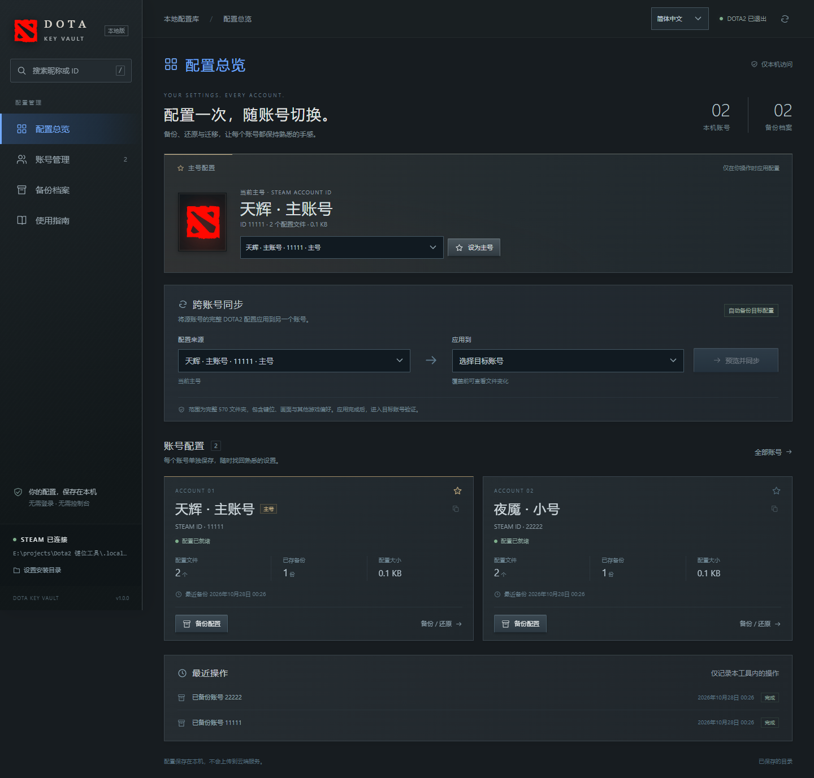
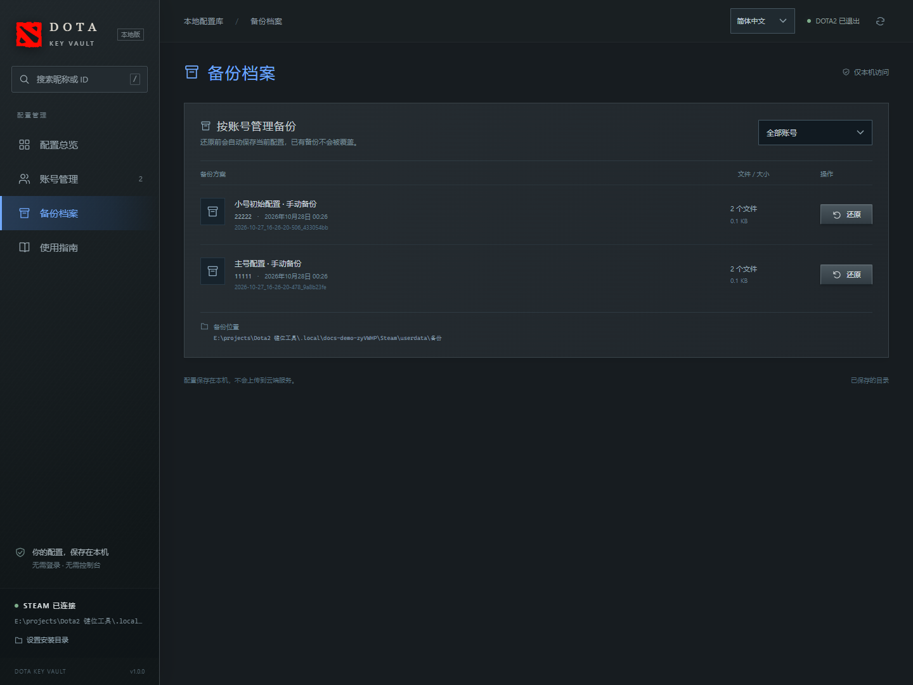
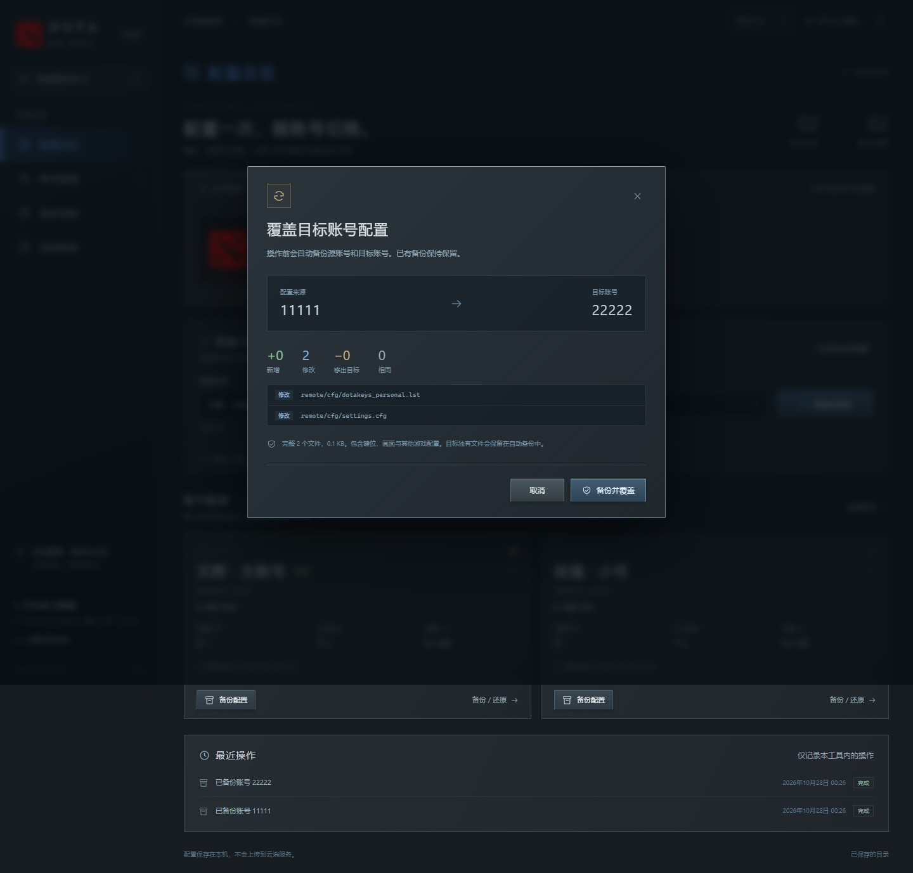
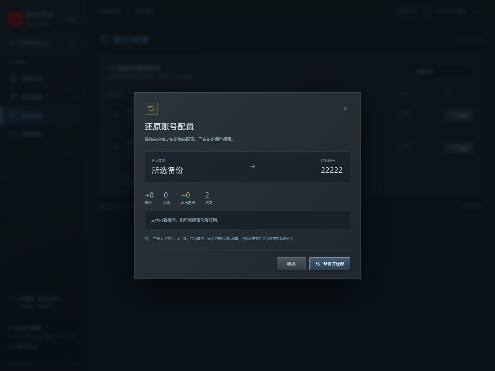

# DOTA Key Vault

中文 | [English](README.en.md)

Windows 本地 DOTA2 配置管理工具。把常用账号的配置保存下来，再应用到其他账号，省去重复设置的麻烦。

**便携版解压即用，无需安装 Node.js、执行 npm install 或登录额外账号。** 支持按账号备份与还原、跨账号同步、主号选择，以及本地昵称和头像显示。

**普通用户：** 前往本仓库的 **Releases** 下载 Windows x64 便携版 ZIP，完整解压后双击 `启动工具.cmd`。GitHub 的 **Code → Download ZIP** 是源码包，不包含 Node.js 运行文件；源码启动方式见[开发与打包](#开发与打包)。

> 管理范围是完整的 `userdata/账号ID/570` 文件夹，包含键位、英雄专属设置、施法偏好、画面和其他游戏配置；并非只迁移键位。操作前请退出 DOTA2，等待 Steam 云同步完成。



本文截图来自当前应用的真实浏览器界面，使用 `11111`、`22222` 两个隔离演示账号。昵称、文件数量及路径仅作示例，没有使用真实账号备份。

## 目录

- [开始使用](#开始使用)
- [切换语言](#切换语言)
- [选择 Steam 安装目录](#选择-steam-安装目录)
- [选择主号](#选择主号)
- [备份配置](#备份配置)
- [同步到其他账号](#同步到其他账号)
- [还原与撤销](#还原与撤销)
- [配置和备份保存在哪里](#配置和备份保存在哪里)
- [常见问题](#常见问题)
- [分享与更新](#分享与更新)
- [开发与打包](#开发与打包)

## 开始使用

### 运行条件

| 条件 | 说明 |
| --- | --- |
| Windows x64 | 便携包内置 Windows x64 Node.js 24.12.0 |
| 浏览器 | 推荐使用 Chrome 或 Edge |
| Steam 与 DOTA2 | 需有本机 Steam 安装目录及账号配置 |
| 目标账号已初始化 | 在本机登录过该账号，至少启动一次 DOTA2 后正常退出 |
| 目录访问权限 | 工具所在目录可写，Windows 用户可读写 Steam 的 `userdata` |

正常使用无需互联网或 Steam API Key。文件夹选择窗口使用 Windows 自带的 Windows PowerShell；不要删除包内的 `runtime`、`server`、`public` 或 `tools` 文件夹。

### 第一次启动

1. 将便携版 ZIP **完整解压**到可写目录，不要在压缩包里直接运行。
2. 双击 `启动工具.cmd`。
3. 等待浏览器自动打开，保持启动窗口运行。
4. 检查左下角是否显示“STEAM 已连接”，确认账号列表符合预期。
5. 退出 DOTA2，等待 Steam 云同步完成，然后开始备份或同步。

默认地址为 `http://127.0.0.1:5700`。若旧版本或其他程序占用端口，启动器会自动尝试后续端口。**请以启动窗口打印或自动打开的地址为准。**

再次启动时，只复用相同安装目录、相同代码版本的服务。停止工具可在启动窗口按 `Ctrl+C` 或关闭窗口。不能通过双击 `public/index.html` 使用。

## 切换语言

页面右上角可选择 **简体中文 / English**，切换导航、按钮、弹窗、标准操作提示和日期格式。首次按浏览器语言选择，之后记住用户选择。昵称、路径、账号 ID、自定义备份备注和配置内容保持原样。语言偏好保存在当前浏览器、当前本地地址中；更换端口或清理浏览器数据后可能需要重新选择。系统文件夹窗口的按钮语言由 Windows 决定。

英文教程及英文界面截图见 [README.en.md](README.en.md)。

## 选择 Steam 安装目录

通常会从 Windows 注册表或常见安装位置自动识别，无需手动设置。需要切换时：

1. 点击左下角 **“设置安装目录”**。
2. 在弹出的 Windows 文件夹窗口中选择 Steam 文件夹，例如 `D:\steam`。
3. 点击确定，工具会自动校验、保存目录并重新扫描账号。

应选择同时包含 `steam.exe` 和 `userdata` 的安装目录，**不是** `steamapps\common\dota 2 beta` 游戏目录或其他游戏库。取消选择保留原设置；选择错误目录会提示错误，不会保存为当前目录。

页面等待选择结果时，请完成或取消系统弹窗；超过约 5 分钟会超时。目录选择由本地服务调用系统窗口完成，浏览器本身无法把选中文件夹的完整路径提供给服务。

## 选择主号

在“配置总览”的 **“主号配置”** 中选择常用账号，点击 **“设为主号”**；也可以点击账号卡片右上角的星标。

- 主号会作为跨账号同步的默认配置来源，按 Steam 安装目录分别记住。
- 账号卡片及选择器优先显示昵称，同时保留 ID；可通过昵称或 ID 搜索账号。
- 主号区域优先显示该账号的本地缓存头像，没有头像时显示 DOTA2 标志。
- 主号选择不会在 Steam 登录、切换账号或启动游戏时自动覆盖配置。

本工具不提供逐键编辑和键位预览；请在 DOTA2 内设置好键位，再通过工具管理整份配置。

## 备份配置

1. 退出 DOTA2，等待 Steam 云同步完成。
2. 在账号卡片点击 **“备份配置”**。
3. 等待校验成功提示，进入左侧 **“备份档案”** 查看记录。

每次都会创建独立备份，不覆盖已有档案。备份保存在对应账号 ID 下，可按账号筛选。



建议在第一次同步前，先给常用账号保存一份手动备份。游戏仍在运行时，备份和覆盖等文件操作会被禁用。

## 同步到其他账号

例如，将主号 `11111` 的配置应用到小号 `22222`：

1. 在“跨账号同步”区域，把 **“配置来源”** 选为主号，把 **“应用到”** 选为小号。
2. 点击 **“预览并同步”**。
3. 核对弹窗中方向为 **`11111 → 22222`**，查看文件变化。
4. 点击 **“备份并覆盖”**，等待完成。
5. 登录目标账号，进入游戏设置及英雄试用验证；正常退出、等待同步并重新启动一次，确认设置仍正确。



| 差异 | 含义 |
| --- | --- |
| 新增 | 来源中存在、目标中没有的文件 |
| 修改 | 同一路径的文件内容不同 |
| 移出目标 | 目标独有的文件，不包含在即将应用的配置中 |
| 相同 | 路径及内容一致的文件 |

确认后会先分别备份源账号与目标账号，再替换目标的完整 `570`，源账号文件保持原样。目标独有文件会保存在覆盖前自动备份中。预览后配置发生变化时，需要重新预览。

## 还原与撤销

1. 打开 **“备份档案”**，筛选对应账号。
2. 找到需要的备份记录，点击 **“还原”**。
3. 查看变化和目标账号，点击 **“备份并还原”**。
4. 等待校验完成，再进入游戏验证。



还原前会自动备份当前配置；还原后，目标 `570` 与所选快照保持一致。

| 想撤销的操作 | 在该账号的备份档案中选择 |
| --- | --- |
| 跨账号同步 | “从某账号覆盖前自动备份” |
| 还原 | “还原前自动备份” |

工具没有自动清理历史备份的功能。备份可用于恢复，请不要随意修改其中的文件或校验清单。

## 配置和备份保存在哪里

```text
Steam 安装目录/
├─ config/
│  ├─ loginusers.vdf                只读昵称缓存
│  └─ avatarcache/SteamID64.png     只读头像缓存
└─ userdata/
   ├─ 11111/570/                   账号当前的 DOTA2 配置
   ├─ 22222/570/                   另一个账号的 DOTA2 配置
   └─ 备份/
      └─ 账号ID/
         └─ 时间戳_随机编号/
            ├─ 570/                完整快照
            └─ backup-manifest.json  SHA256 校验清单
```

工具偏好、主号和操作记录存放在**工具目录**的 `.local/settings.json`，启动日志为 `.local/launcher.log`。实际备份存放在 **Steam 的 userdata** 下，不在工具目录中。

备份与迁移的写入范围为目标账号的 `570` 以及 `userdata/备份`；不会复制其他游戏或修改 Steam 账号登录文件。兼容本项目早期 PowerShell 备份清单和 `file-hashes.json`。清单不完整、文件被篡改或存在不安全路径时，会阻止自动还原。

文件操作具有进程检查、SHA256 校验、差异预览、操作前自动备份、写入串行和暂存替换保护；这些检查不能替代游戏内验证。**Steam Cloud 可能重新同步配置，云同步状态仍需在 Steam 中确认。**

## 常见问题

### 为什么没有找到账号，或显示“尚未初始化”？

工具只扫描本机 `userdata` 的数字 ID 文件夹。请在此电脑登录目标账号，启动一次 DOTA2 后正常退出，再点击页面右上角重新扫描。确认选中的是正确的 Steam 安装目录。

### 为什么昵称或头像不显示，或不是最新的？

昵称只读取 `config/loginusers.vdf` 的 `PersonaName`，按 SteamID64 换算账号 ID 匹配；头像只读取 `config/avatarcache/SteamID64.png`。缺失或读取失败时，回退显示 ID 或 DOTA2 标志。不会联网补取缓存，也不会把登录名等登录信息发给前端。

### 为什么按钮是灰色的？

检查 DOTA2 是否仍在运行、账号是否有可用配置、是否有操作正在进行。同步必须选择两个不同账号。文件夹选择弹窗未关闭时，也需先完成或取消选择。

### 文件夹窗口没有出现怎么办？

先确认使用的是本次启动自动打开的地址，避免继续访问旧服务。查看任务栏或按 `Alt+Tab` 找到文件夹窗口；无法启动时页面会显示提示，启动窗口会输出错误信息。系统需允许 Windows PowerShell 和 Windows Forms 运行，无需全局修改执行策略。

### 双击启动后没有页面，或一直显示连接中？

确认已完整解压，`runtime/node.exe` 存在，启动窗口仍在运行。按窗口显示的实际地址打开网页；更新后按 `Ctrl+F5` 刷新。如仍失败，查看 `.local/launcher.log` 和启动窗口报错。不要把不同版本文件零散混用。

### 提示权限不足或文件被占用怎么办？

退出 DOTA2，检查是否有其他程序占用配置文件，并使用有权读写 Steam 目录的 Windows 用户运行。不要在备份、同步或还原过程中关闭服务。

### 可以只迁移键位吗？

当前版本使用已实机验证的完整 `570` 快照方案，包含画面等其他偏好，不支持筛选只迁移键位。完成后请检查目标账号的画面设置和按键。

## 分享与更新

直接分享 `dist` 中最新的 Windows x64 ZIP。对方完整解压后双击启动文件即可，不需要安装 Node.js、npm 或数据库。

发布包包含应用、启动脚本、中英文 README、中英文界面截图、内置运行环境及 Node.js 许可；不包含本机 `.local`、个人账号数据、实机记录和个人备份。**README 引用 `docs/images` 的图片，分享时请保留这个目录。**

更新时建议关闭旧工具，将新版解压到新目录，再启动。Steam 中的备份仍在原位置；新目录里的工具可能需要重新指定 Steam 目录和主号。若旧服务未退出，新版启动器会尝试其他端口，请使用自动打开的地址。

## 开发与打包

源码运行需要 Node.js 22 或更新版本；无第三方运行依赖，无需 `npm install`。仅下载源码时，`runtime/node.exe` 不一定存在；可安装系统 Node.js，便携包则已内置运行环境。

```powershell
npm start          # 直接启动服务，默认端口 5700
npm run dev        # 服务端变更自动重启
npm run check      # JavaScript 语法检查
npm test           # 隔离假账号测试，不修改真实 Steam 配置
```

便携版不包含 npm，也可使用内置运行时直接启动：

```powershell
.\runtime\node.exe tools/launch.mjs
```

指定端口或 Steam 目录：

```powershell
$env:PORT = '5702'
$env:STEAM_PATH = 'D:\steam'
.\runtime\node.exe tools/launch.mjs
```

源码维护者生成便携包：

```powershell
powershell -NoProfile -ExecutionPolicy Bypass -File tools/build-portable.ps1
```

需预先准备 `runtime/node.exe`、`runtime/LICENSE.txt` 和运行环境说明；产物位于 `dist`。升级运行时应同步更新许可、版本说明并重新验证。

| 目录 / 文件 | 用途 |
| --- | --- |
| `public/` | 原生 HTML、CSS 和 JavaScript 界面 |
| `server/` | HTTP 接口、Steam 识别、文件操作与系统目录选择 |
| `tools/launch.mjs` | 启动、版本识别和浏览器打开 |
| `tools/build-portable.ps1` | 维护者使用的便携包构建脚本 |
| `tools/ui-fixture.mjs` | 源码中的隔离 UI 验收环境 |
| `tests/` | 临时假账号功能与接口测试 |
| `docs/images/` | 本教程的实际界面截图 |
| `runtime/` | 便携运行环境与许可 |
| `.local/` | 本机偏好、日志及开发临时数据，不随包分发 |

界面支持键盘焦点、模态框和减少动画偏好。服务仅监听本机回环地址，校验 Host、Origin 和写操作会话令牌，不使用外部字体、图片或分析服务。

这是独立社区工具，与 Valve 无官方关联。
